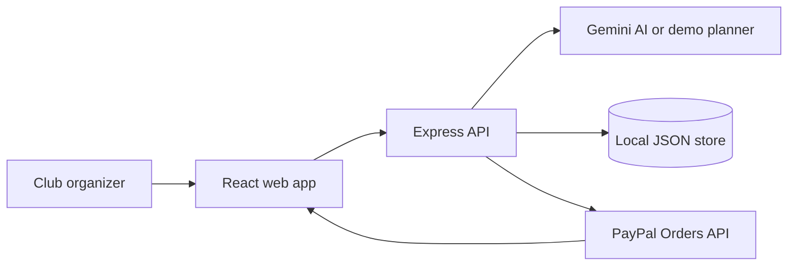

# ClubPay AI

**AI-assisted procurement and approval workflows with PayPal Sandbox checkout.**

ClubPay AI helps college clubs and small teams plan purchases against a budget, compare sample vendors, route purchases through human approval, and pay approved orders through PayPal Sandbox.

## Features
- Natural-language procurement planning with Gemini (optional).
- Clearly labelled deterministic demo mode when no AI key is configured.
- Sample vendor catalogue and price comparisons.
- Server-side budget and approval validation.
- PayPal Orders API: create order and capture approved payment.
- Transaction history and budget summary.
- AI financial summary (Gemini or clearly labelled demo analysis).

## Requirements
- Node.js 20+
- npm
- Optional Gemini API key
- PayPal Developer Sandbox REST app credentials to test checkout

## Run locally
1. Copy `.env.example` to `.env` in the repository root.
2. Add credentials if available. Never expose `PAYPAL_CLIENT_SECRET` in frontend code.
3. Install and run:
   ```bash
   npm install
   npm run dev
   ```
4. Open http://localhost:5173.

The backend runs at http://localhost:4000.

## PayPal Sandbox setup
1. Create a REST app in the PayPal Developer Dashboard: https://developer.paypal.com/dashboard/
2. Copy the Sandbox Client ID and Secret into the root `.env`.
3. Keep `PAYPAL_BASE_URL=https://api-m.sandbox.paypal.com`.
4. Restart the server. The checkout button loads the PayPal JavaScript SDK when a Client ID is configured.
5. Use a Sandbox personal/buyer account to approve checkout.
6. The backend captures the approved order and verifies the captured amount/currency before recording it.

Without credentials, the app disables PayPal checkout rather than simulating a successful payment.

## AI setup
Set `GEMINI_API_KEY` in `.env`. The backend calls the Gemini generateContent API. If no key is configured, ClubPay uses a deterministic, clearly labelled demo planner. Do not describe demo-mode output as LLM-generated.

## Security notes
- PayPal secret and Gemini API key are server-only.
- The MVP includes a local demo user and local JSON persistence for quick evaluation, not production identity management.
- Before public production use, replace demo authentication with a proper identity provider, add CSRF/rate limiting, use a managed database, and conduct a security review.
- Never use production PayPal credentials for this hackathon demo.

## Main API
- `GET /api/health`
- `GET /api/catalog`
- `GET /api/dashboard`
- `POST /api/ai/plan`
- `POST /api/ai/report`
- `POST /api/purchases/:id/approve`
- `POST /api/payments/create-order`
- `POST /api/payments/capture-order`
- `GET /api/payments/history`

## Architecture


## Demo scenario
Try: "We are organizing a technical fest for 100 students. Our budget is 25000 INR. We need food, stationery, certificates and decorations."

The app uses sample vendors and displays all prices in INR for planning. PayPal Sandbox checkout uses USD by default; the server converts the approved INR plan to USD using a clearly labelled configurable demo exchange rate. This is a demo estimate, not a live FX quote.
